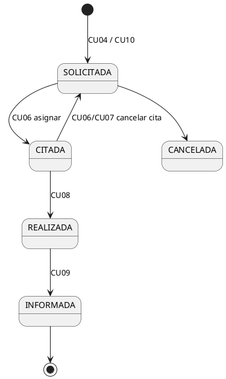

# Arquitectura (línea base)

Las reglas que deben respetar humanos y agentes están en [CONTEXT.md](../../CONTEXT.md). Decisiones
relacionadas: D-002, D-007, D-008, D-009, D-010, D-011.

## 1. Módulos Maven

```
radiodiagnostico (pom padre, producto)
├── servidor (jar) ── modelo, servicios, controladores y contratos api
└── cliente  (jar) ── vista de consola + controladores; depende de servidor y solo usa su paquete api
```

## 2. Capas del servidor

```plantuml
@startuml
package cliente { [Vista] --> [Controlador cliente] }
package servidor {
  interface "ApiXxx" as API
  [ControladorXxx] ..|> API
  [ControladorXxx] --> [ControlAcceso]
  [ControlAcceso] --> [Auditor]
  interface "ServicioXxx" as SRV
  [ControladorXxx] --> SRV
  [ServicioXxxImpl] ..|> SRV
  [ServicioXxxImpl] --> [Dominio]
  interface "Repositorio<T,ID>" as REP
  [ServicioXxxImpl] --> REP
  [RepositorioEnMemoria] ..|> REP
  interface "SistemaPacs / SistemaHce / ..." as EXT
  [ServicioXxxImpl] --> EXT
  [Simulados] ..|> EXT
  [Servidor] ..> [ControladorXxx] : crea (raíz de composición)
}
[Controlador cliente] --> API
@enduml
```

Cada componente expone **dos** interfaces:
- `ServicioXxx` (contrato interno): lo usan otros componentes del servidor. Sin seguridad.
- `ApiXxx` (contrato externo): lo usa el cliente. Cada método recibe el *token* y exige un permiso.

## 3. Componentes (paquetes de `es.uclm.esi.iso2.servidor`)

| Paquete | Responsabilidad | CU |
|---|---|---|
| `comun` | Repositorio genérico, excepciones, validaciones | — |
| `seguridad` | Usuarios, sesiones, roles, permisos, control de acceso | CU01, CU17 |
| `integracion` | Interfaces de SSO, HCE, Admisión, RIS/PACS y simulados | CU01, CU09, CU19 |
| `pacientes` | Alta, modificación y baja de pacientes | CU02 |
| `catalogo` | Tipos de prueba, modalidades, prioridades y parámetros | CU03 |
| `solicitudes` | Solicitudes de prueba y su ciclo de vida | CU04, CU14 |
| `agendas` | Agendas diarias y huecos | CU05, CU14 |
| `citas` | Citas: asignar, reprogramar, cancelar, confirmar | CU06, CU07 |
| `realizacion` | Registro de realización e incidencias técnicas | CU08 |
| `informes` | Informes radiológicos e imágenes | CU09 |
| `seguimiento` | Pruebas de seguimiento periódicas | CU10, CU16 |
| `esperas` | Listas de espera, prioridades y huecos | CU11 |
| `notificaciones` | Notificaciones y recordatorios | CU12 |
| `historial` | Historial de pruebas del paciente | CU13 |
| `atencion` | Incidencias del paciente y encuestas | CU15 |
| `auditoria` | Registro y consulta de accesos | CU18 |
| `estadisticas` | Estadísticas del médico, informes operativos y globales | CU20–CU22 |
| `api` / `controlador` | Contratos con el cliente y su implementación | todos |

## 4. Ciclo de vida de una solicitud


