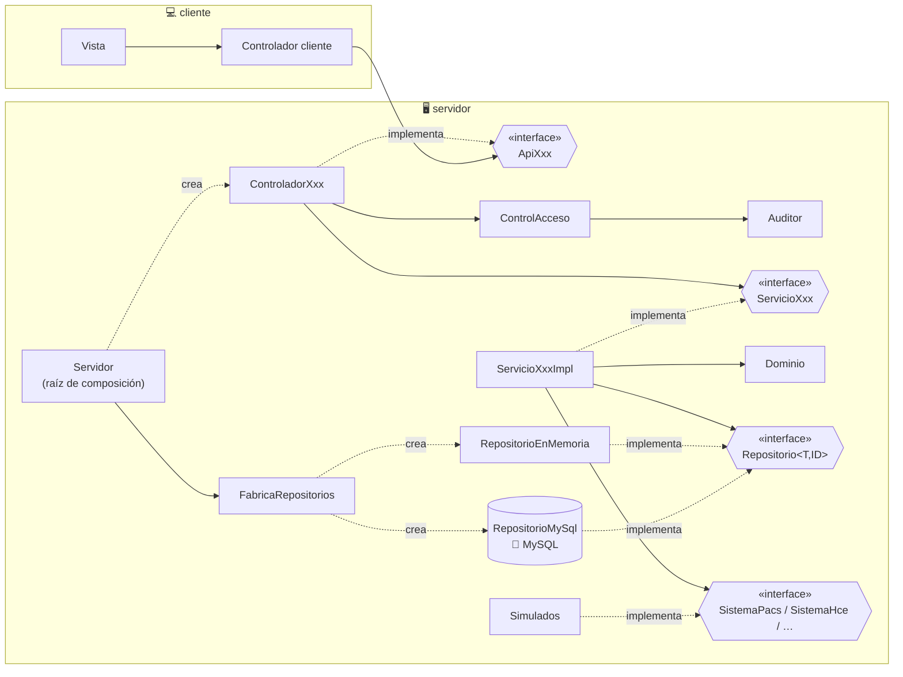
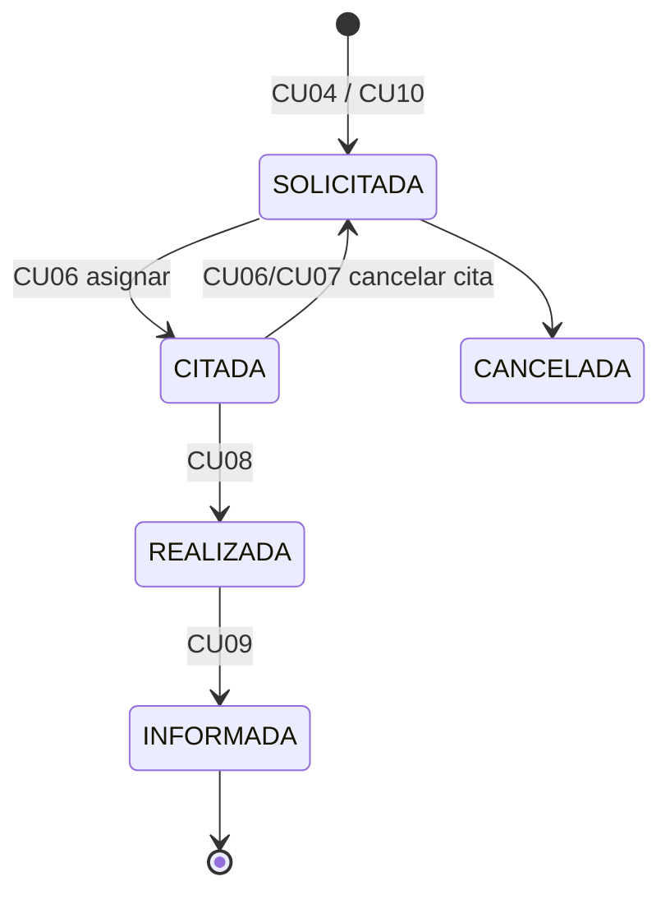

# 🏛️ Arquitectura (línea base)

[🏠 Inicio](Home.md)

> Módulos Maven, capas del servidor, componentes por caso de uso, ciclo de vida de una solicitud y persistencia en MySQL.

---

Las reglas que deben respetar humanos y agentes están en [CONTEXT.md](../../CONTEXT.md). Decisiones
relacionadas: D-002, D-007, D-008, D-009, D-010, D-011.

## 📦 1. Módulos Maven

```
radiodiagnostico (pom padre, producto)
├── servidor (jar) ── modelo, servicios, controladores y contratos api
└── cliente  (jar) ── vistas JavaFX (FXML) y de consola + controladores; depende de servidor y solo usa su paquete api
```

## 🧅 2. Capas del servidor



Cada componente expone **dos** interfaces:
- `ServicioXxx` (contrato interno): lo usan otros componentes del servidor. Sin seguridad.
- `ApiXxx` (contrato externo): lo usa el cliente. Cada método recibe el *token* y exige un permiso.

## 🧩 3. Componentes (paquetes de `es.uclm.esi.iso2.servidor`)

| Paquete | Responsabilidad | CU |
|---|---|---|
| `comun` | Interfaz `Repositorio`, `Secuencia` de ids, excepciones, validaciones | — |
| `persistencia` | Implementaciones de `Repositorio` (`RepositorioEnMemoria`, `RepositorioMySql`), `FabricaRepositorios` (memoria o MySQL según el entorno), `ConfiguracionBd` | D-018 |
| `seguridad` | Usuarios, sesiones, roles, permisos (política configurable), control de acceso, interfaz `Auditor` | CU01, CU17, CU18 |
| `integracion` | Interfaces de SSO, HCE, Admisión, RIS/PACS (`SistemaExterno`) y simulados | CU01, CU09, CU19 |
| `sincronizacion` | Sincronizaciones con Admisión y HCE y estado de los sistemas externos (orquesta los adaptadores de `integracion`) | CU19 |
| `pacientes` | Alta, modificación y baja de pacientes | CU02 |
| `catalogo` | Tipos de prueba, modalidades, prioridades y parámetros | CU03 |
| `solicitudes` | Solicitudes de prueba y su ciclo de vida | CU04, CU14 |
| `agendas` | Agendas diarias y huecos | CU05, CU14 |
| `citas` | Citas: asignar, reprogramar, cancelar, confirmar; recordatorios de citas (tarea programada) | CU06, CU07, CU12 |
| `realizacion` | Registro de realización e incidencias técnicas | CU08 |
| `informes` | Informes radiológicos e imágenes | CU09 |
| `seguimiento` | Pruebas de seguimiento periódicas | CU10, CU16 |
| `esperas` | Listas de espera, prioridades y huecos | CU11 |
| `notificaciones` | Buzón de notificaciones del paciente y `Notificador` | CU12 |
| `historial` | Historial de pruebas del paciente | CU13 |
| `atencion` | Incidencias del paciente y encuestas | CU15 |
| `auditoria` | Registro y consulta de accesos | CU18 |
| `estadisticas` | Estadísticas del médico, informes operativos y globales | CU20–CU22 |
| `api` / `controlador` | Contratos con el cliente y su implementación | todos |

### Cliente (D-017)

| Paquete de `es.uclm.esi.iso2.cliente` | Responsabilidad |
|---|---|
| `controlador` | `Accion` (operación de la API con sus `Campo` tipados), `Valores` (interpreta lo escrito), `Resultado`, catálogo de acciones por rol (`AccionesPaciente`, `AccionesMedico`, `AccionesAdmision`, `AccionesAdministrador`; el médico tiene las del paciente, D-005), `SesionCliente` (CU01) y `AplicacionCliente` (controlador de la consola) |
| `vista.fx` | JavaFX: `login.fxml` y `principal.fxml` con sus controladores de vista. El formulario de cada acción se genera a partir de sus campos |
| `vista` | Consola (`--consola`), usada también en las pruebas de sistema |

Las dos vistas usan los mismos controladores. Añadir una operación al cliente es añadir una `Accion` al
catálogo del rol, sin tocar las vistas (OCP). El cliente solo depende de la interfaz `api.Apis` (acceso a los contratos
`ApiXxx`), que implementa `Servidor`; solo `Main`, la raíz de composición del cliente, crea el `Servidor`.

### Capas por componente (D-021)

Los paquetes son **por componente**. Las capas de D-007 son conjuntos de clases dentro de cada componente, no
paquetes. Los métodos que cambian el estado de una entidad son de paquete: solo los usa su servicio (D-022).

| Componente | API (`api`) | Controlador (`controlador`) | Servicio (interfaz → implementación) | Dominio (entidades y valores) |
|---|---|---|---|---|
| `seguridad` | `ApiSesion`, `ApiPermisos` | `ControladorSesion`, `ControladorPermisos` | `ServicioSesion`, `ServicioPermisos` → `…Impl`; `ControlAcceso` | `Usuario`, `Rol`, `Permiso`, `PoliticaPermisos`, `Sesion` |
| `pacientes` | `ApiPacientes` | `ControladorPacientes` | `ServicioPacientes` → `ServicioPacientesImpl` | `Paciente`, `Dni`, `DatosPaciente` |
| `catalogo` | `ApiCatalogo` | `ControladorCatalogo` | `ServicioCatalogo` → `ServicioCatalogoImpl` | `TipoPrueba`, `ParametrosSistema`, `Modalidad`, `Prioridad` |
| `solicitudes` | `ApiSolicitudes`, `ApiEstadoSolicitudes` | `ControladorSolicitudes`, `ControladorEstadoSolicitudes` | `ServicioSolicitudes` → `ServicioSolicitudesImpl` | `SolicitudPrueba`, `EstadoSolicitud`, `DatosSolicitud` |
| `agendas` | `ApiAgendas` | `ControladorAgendas` | `ServicioAgendas` → `ServicioAgendasImpl` | `Agenda`, `Hueco`, `HuecoLibre`, `DatosAgenda` |
| `citas` | `ApiCitas`, `ApiMisCitas` | `ControladorCitas`, `ControladorMisCitas` | `ServicioCitas` → `ServicioCitasImpl`; `ServicioRecordatorios` | `Cita`, `EstadoCita`, `SituacionSolicitud` |
| `realizacion` | `ApiRealizacion` | `ControladorRealizacion` | `ServicioRealizacion` → `ServicioRealizacionImpl` | `Incidencia`, `TipoIncidencia` |
| `informes` | `ApiInformes` | `ControladorInformes` | `ServicioInformes` → `ServicioInformesImpl` | `Informe` |
| `seguimiento` | `ApiSeguimiento`, `ApiMisSeguimientos` | `ControladorSeguimiento`, `ControladorMisSeguimientos` | `ServicioSeguimiento` → `ServicioSeguimientoImpl` | `Seguimiento`, `EstadoSeguimiento`, `DatosSeguimiento` |
| `esperas` | `ApiEsperas` | `ControladorEsperas` | `ServicioEsperas` → `ServicioEsperasImpl` | `EntradaEspera` |
| `notificaciones` | `ApiNotificaciones` | `ControladorNotificaciones` | `ServicioNotificaciones` → `ServicioNotificacionesImpl`; `Notificador` | `Notificacion`, `TipoNotificacion` |
| `historial` | `ApiHistorial` | `ControladorHistorial` | `ServicioHistorial` → `ServicioHistorialImpl` | `EntradaHistorial` |
| `atencion` | `ApiAtencionPaciente`, `ApiAtencion` | `ControladorAtencionPaciente`, `ControladorAtencion` | `ServicioAtencion` → `ServicioAtencionImpl` | `IncidenciaPaciente`, `Encuesta`, `CategoriaIncidencia`, `EstadoIncidencia` |
| `auditoria` | `ApiAuditoria` | `ControladorAuditoria` | `ServicioAuditoria` → `ServicioAuditoriaImpl` (implementa `seguridad.Auditor`) | `RegistroAuditoria` |
| `sincronizacion` | `ApiIntegracion` | `ControladorIntegracion` | `ServicioIntegracion` → `ServicioIntegracionImpl` | `Sincronizacion`, `EstadoSistema`, `TipoSincronizacion` |
| `estadisticas` | `ApiEstadisticasMedico`, `ApiInformesOperativos`, `ApiEstadisticasGlobales` | `ControladorEstadisticasMedico`, `ControladorInformesOperativos`, `ControladorEstadisticasGlobales` | `ServicioEstadisticasMedico`, `ServicioInformesOperativos`, `ServicioEstadisticasGlobales` → `…Impl` | `EstadisticasMedico`, `InformeOperativo`, `EstadisticasGlobales`, `Periodo` |

Fuera de los componentes:
- `integracion` contiene las interfaces de los sistemas externos (`SistemaExterno`, `ProveedorSso`, `SistemaPacs`,
  `SistemaHce`, `SistemaAdmision`) y sus simulados.
- `persistencia` contiene las implementaciones de `comun.Repositorio`.
- `Servidor` es la raíz de composición e implementa `api.Apis`.

## 🔄 4. Ciclo de vida de una solicitud



## 🐬 5. Persistencia en MySQL (D-018)

- Cada almacén (pacientes, solicitudes, citas…) es una **tabla** `(orden, id, datos)` que la aplicación crea al
  arrancar. Cada fila guarda un **agregado** completo serializado (por ejemplo, una agenda con sus huecos),
  identificado por su id; `orden` conserva el orden de inserción.
- Al leer, un **filtro de deserialización** solo admite clases del servidor y del JDK.
- Los ids de cada componente los genera `Secuencia`, que continúa desde el mayor id guardado.
- Se elige con variables de entorno: si existe `RADIO_DB_URL` se usa MySQL; si no, memoria.

| Variable | Ejemplo |
|---|---|
| `RADIO_DB_URL` | `jdbc:mysql://127.0.0.1:3306/radiodiagnostico` |
| `RADIO_DB_TEST_URL` | `jdbc:mysql://127.0.0.1:3306/radiodiagnostico_test` (pruebas de integración) |
| `RADIO_DB_USUARIO` / `RADIO_DB_CLAVE` | usuario y contraseña de la aplicación (nunca en el repositorio) |

Los sistemas externos simulados (SSO, HCE, Admisión, PACS) y las sesiones siguen en memoria: no son datos de la aplicación.
---

[🏠 Inicio](Home.md) · [⬆️ Arriba](#)
