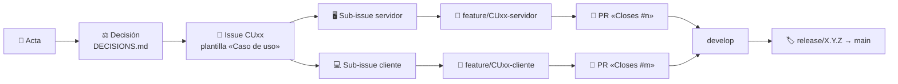

<div align="center">

# 🏥 Radiodiagnóstico SESCAM

**Sistema Integral de Gestión de Radiodiagnóstico e Imagen Médica**
<br>Ingeniería del Software II · UCLM · curso 2026/27

[](https://github.com/CarmenOrmeno/ISO26-ISO2-Grupo/actions/workflows/maven.yml)
[](https://github.com/CarmenOrmeno/ISO26-ISO2-Grupo/releases)


</div>

---

> 📖 Esta wiki es la **guía de lectura** del proyecto: desde aquí se llega a todos los artefactos.
> Las páginas se escriben en [`docs/wiki/`](https://github.com/CarmenOrmeno/ISO26-ISO2-Grupo/tree/develop/docs/wiki) y se publican aquí automáticamente
> en cada cambio de `develop`.

## 🧭 Por dónde empezar

| | Página | Qué contiene |
|:---:|---|---|
| 👥 | [Equipo y roles](Equipo-y-roles.md) | Quién es quién, quién coordina y quién aprueba qué |
| 📝 | [Actas de reuniones](Actas-de-reuniones.md) | Una por reunión, con decisiones y compromisos → issues |
| 🎯 | [Requisitos y casos de uso](Requisitos-y-casos-de-uso.md) | RF, actores, diagramas y especificación de cada CU |
| 📅 | [Planificación](Planificacion.md) | Fases, iteraciones, esfuerzo RADIT, costes, fechas y versiones |
| 🏛️ | [Arquitectura](Arquitectura.md) | Módulos, capas, paquetes e interfaces (contratos) |
| 🔀 | [Plan de gestión de configuración](Plan-de-gestion-de-configuracion.md) | Git Flow, versiones, responsables, CI |
| 🛡️ | [Plan de calidad](Plan-de-calidad.md) | Características ISO 25010 priorizadas y cómo se controlan |
| 🧪 | [Plan de pruebas](Plan-de-pruebas.md) | Diseño de casos de prueba y resultados de Surefire y JaCoCo |
| ⚖️ | [Decisiones](Decisiones.md) | Registro de decisiones del proyecto (D-001 … D-020) |
| 🪞 | [Autoevaluación y experiencia](Autoevaluacion-y-experiencia.md) | Una por persona (obligatoria) |

## 🚦 Estado del proyecto

| Versión | Fecha | Contenido | Estado |
|---|---|---|:---:|
| 🏷️ [v0.1.0](https://github.com/CarmenOrmeno/ISO26-ISO2-Grupo/releases/tag/v0.1.0) | 08/11 | Línea base de la arquitectura: CU01–CU06 | ✅ |
| 🏷️ [v0.2.0](https://github.com/CarmenOrmeno/ISO26-ISO2-Grupo/releases/tag/v0.2.0) | 22/11 | Flujo clínico y avisos al paciente: servidor de CU07–CU12, CU14, CU16 | ✅ |
| 🏷️ v1.0.0 | 11/12 | Producto completo: CU13, CU15, CU17–CU22, cliente JavaFX, persistencia MySQL (✅ hecha) | 🚧 |

### Casos de uso

| Fase | CU | Servidor | Cliente |
|---|---|:---:|:---:|
| 🧱 Elaboración | [CU01](../casos-de-uso/CU01.md) · [CU02](../casos-de-uso/CU02.md) · [CU05](../casos-de-uso/CU05.md) · [CU06](../casos-de-uso/CU06.md) | ✅ | ✅ |
| 🧱 Elaboración | [CU03](../casos-de-uso/CU03.md) · [CU04](../casos-de-uso/CU04.md) | ✅ | ⏳ |
| 🔨 Construcción | [CU07](../casos-de-uso/CU07.md) · [CU08](../casos-de-uso/CU08.md) · [CU09](../casos-de-uso/CU09.md) · [CU10](../casos-de-uso/CU10.md) · [CU11](../casos-de-uso/CU11.md) · [CU12](../casos-de-uso/CU12.md) · [CU13](../casos-de-uso/CU13.md) · [CU14](../casos-de-uso/CU14.md) · [CU15](../casos-de-uso/CU15.md) · [CU16](../casos-de-uso/CU16.md) · [CU17](../casos-de-uso/CU17.md) · [CU18](../casos-de-uso/CU18.md) · [CU19](../casos-de-uso/CU19.md) · [CU20](../casos-de-uso/CU20.md) | ✅ | ⏳ |
| 🔨 Construcción | CU21 · CU22 | ⏳ | ⏳ |

✅ terminado · 🚧 en curso · ⏳ pendiente — el detalle de cada CU está en su
[issue](https://github.com/CarmenOrmeno/ISO26-ISO2-Grupo/issues?q=label%3A%22caso+de+uso%22) y en el
[tablero](https://github.com/users/CarmenOrmeno/projects/1).

## 🔗 Trazabilidad



Cada CU tiene su especificación en [docs/casos-de-uso/](../casos-de-uso/) y sus ramas `feature/CUxx-…`,
que no se borran al fusionar. En *Insights → Network* se ve la historia de las ramas.

## 🚀 Probarlo en 1 minuto

```bash
mvn verify                 # compila y pasa las pruebas (las de MySQL, si hay RADIO_DB_TEST_URL)
java -jar cliente/target/cliente-*.jar
```

Usuarios de demostración: `paciente1`, `medico1`, `admision1`, `admin1` · contraseña `demo`.
