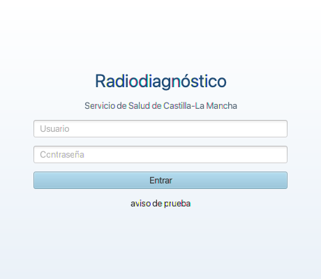
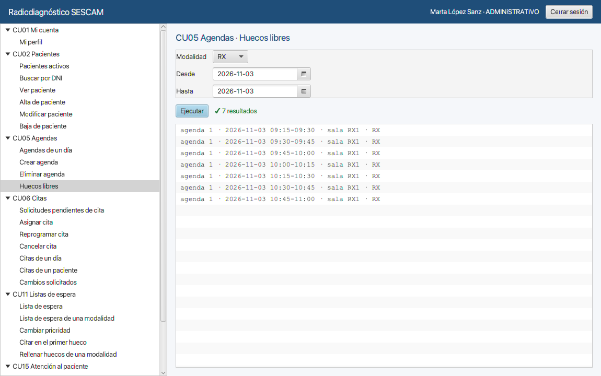

# 📘 Manual de usuario y de despliegue

[🏠 Inicio](Home.md)

> Cómo instalar, arrancar y usar la aplicación de Radiodiagnóstico (v1.0.1): requisitos, base de datos, la
> ventana principal, qué puede hacer cada perfil, un recorrido guiado y solución de problemas.

---

## 🧰 1. Requisitos

| Para | Necesitas |
|---|---|
| Usar la aplicación | Java 21 y una pantalla (la vista JavaFX va dentro del jar) |
| Construirla | Maven 3.9 y conexión a Maven Central la primera vez |
| Guardar los datos | Nada (memoria) o **MySQL 8** si los datos deben conservarse al cerrar (D-018) |

El jar se construye para la plataforma en la que se compila (macOS, Linux o Windows), porque JavaFX lleva
bibliotecas nativas: constrúyelo en el mismo sistema en el que se va a usar.

## 🚀 2. Instalación y arranque

```bash
git clone https://github.com/CarmenOrmeno/ISO26-ISO2-Grupo.git
cd ISO26-ISO2-Grupo
git checkout v1.0.1                                   # versión publicada
mvn -q install -DskipTests                            # construye servidor y cliente
java -jar cliente/target/cliente-2.0.1.jar            # vista gráfica (JavaFX)
java -jar cliente/target/cliente-2.0.1.jar --consola  # vista de consola
```

También se puede abrir desde Maven con `mvn -q -pl cliente javafx:run` (después del `install`). Al
arrancar, la aplicación indica dónde guarda los datos («memoria» o «MySQL jdbc:…»).

> El servidor se ejecuta dentro del mismo proceso que el cliente (D-007): no hay que arrancar nada más.

## 🐬 3. Guardar los datos en MySQL (opcional)

```bash
mysql -uroot -p < scripts/crear-bd.sql                # una vez: bases de datos y usuario (cambia la clave)
export RADIO_DB_URL=jdbc:mysql://127.0.0.1:3306/radiodiagnostico
export RADIO_DB_USUARIO=radiodiagnostico
export RADIO_DB_CLAVE=<tu clave>
java -jar cliente/target/cliente-2.0.1.jar
```

- Las tablas se crean solas al arrancar. Los datos de demostración solo se cargan si la base de datos está vacía.
- Si `RADIO_DB_URL` está definida pero MySQL no responde, la aplicación no arranca y explica por qué. Arranca
  MySQL, revisa las variables o quita `RADIO_DB_URL` para trabajar en memoria.
- Las claves no se guardan nunca en el repositorio.

## 👥 4. Usuarios y datos de demostración

Todos los usuarios tienen la contraseña `demo` (SSO simulado).

| Usuario | Perfil | Nombre |
|---|---|---|
| `paciente1` | Paciente (PAC-1) | Lucía Martín Pérez |
| `medico1` | Médico | Dr. Javier Ruiz Gómez |
| `admision1` | Administrativo (admisión) | Marta López Sanz |
| `admin1` | Administrador | Pedro García Díaz |

Datos de partida: dos pacientes (PAC-1 y PAC-2), cinco tipos de prueba (`RX-TORAX`, `US-ABD`, `MG-CRIBADO`,
`TC-CRANEO`, `RM-RODILLA`), agendas de RX y TC para los cinco días laborables siguientes, dos solicitudes
(la de PAC-1 ya citada), un seguimiento de ecografía de PAC-1, y en el sistema de admisión simulado una
paciente nueva (Rosa Navarro) para probar la importación (CU19).

## 🖥️ 5. La ventana de la aplicación



Escribe el usuario y la contraseña y pulsa **Entrar**. Si los datos no son correctos, el motivo aparece en rojo.



- **Izquierda:** las acciones de tu perfil, agrupadas por caso de uso (CU).
- **Arriba a la derecha:** al elegir una acción aparece su formulario. Las fechas se escriben `AAAA-MM-DD` (o con
  el calendario), las horas `HH:MM`, y las opciones (modalidad, prioridad, rol…) se eligen de una lista. Los
  campos «opcional» se pueden dejar vacíos.
- **Ejecutar:** envía la acción. El resultado sale debajo con ✔ en verde, o ✖ en rojo con el motivo (dato mal
  escrito, falta de permiso, regla de negocio…). Un error nunca cierra la ventana.
- Las consultas que no piden datos (p. ej. «Ver mis citas») se muestran al elegirlas.
- **Cerrar sesión** vuelve a la pantalla de inicio. La sesión caduca tras 30 minutos sin actividad (CU01).

La vista de consola (`--consola`) ofrece las mismas acciones en un menú numerado.

## 🗂️ 6. Qué puede hacer cada perfil

| Perfil | Grupos de acciones |
|---|---|
| 🧑 Paciente | CU01 Mi cuenta · CU07 Mis citas (ver, confirmar, pedir cambio, cancelar) · CU12 Notificaciones · CU13 Historial e informes · CU15 Incidencias y encuestas · CU16 Mis seguimientos |
| 🩺 Médico | Todo lo del paciente (D-005) · CU04 Solicitar pruebas · CU14 Estado de solicitudes y agendas · CU08 Realización e incidencias · CU09 Informes e imágenes · CU10 Seguimientos · CU20 Estadísticas |
| 🗂️ Administrativo | CU02 Pacientes · CU05 Agendas · CU06 Citas · CU11 Listas de espera · CU15 Atención al paciente · CU21 Informes operativos |
| ⚙️ Administrador | CU03 Catálogo y parámetros · Tareas programadas (recordatorios CU12, revisiones de seguimiento CU10) · CU17 Roles y permisos · CU18 Auditoría · CU19 Integración · CU22 Estadísticas globales |

Lo que cada perfil puede hacer depende de la política de permisos, que el administrador puede cambiar (CU17).
Todo acceso a datos clínicos, y todo intento denegado, queda registrado en la auditoría (CU18).

## 🧭 7. Recorrido guiado: una prueba de principio a fin

Es el mismo recorrido que comprueba la prueba de integración `FlujoCompletoTest`.

| Paso | Usuario | Acción | Datos |
|---|---|---|---|
| 1 | `medico1` | CU04 · Solicitar prueba | PAC-1, US-ABD, indicación, justificación, ORDINARIO → anota el **id de la solicitud** |
| 2 | `admision1` | CU05 · Crear agenda | mañana, ECO1, US, medico1, 15:00, 16:00, 15 |
| 3 | `admision1` | CU11 · Citar en el primer hueco | id de la solicitud → anota el **id de la cita** |
| 4 | `paciente1` | CU12 · Mis notificaciones · CU07 · Confirmar cita | aviso de cita; id de la cita |
| 5 | `medico1` | CU08 · Registrar realización | id de la cita, nº de imágenes (a partir de la hora de la cita) |
| 6 | `medico1` | CU09 · Crear informe | id de la solicitud, hallazgos, conclusión |
| 7 | `paciente1` | CU13 · Mi historial / Ver informe · CU15 · Responder encuesta | id de la solicitud, puntuación 1–5 |
| 8 | `admin1` | CU19 · Enviar informes a la HCE · CU18 · Registros de un usuario | paciente1 y las fechas |
| 9 | `admin1` / `admision1` / `medico1` | CU22 · CU21 · CU20 | periodo con las fechas del recorrido |

> La realización (paso 5) solo se puede registrar cuando ya ha llegado la hora de la cita (CU08). La prueba
> automatizada adelanta el reloj; usando la aplicación hay que esperar a esa hora (o, con MySQL, continuar el
> recorrido al día siguiente: los datos se conservan).

## 🩹 8. Solución de problemas

| Síntoma | Causa y solución |
|---|---|
| «Usuario o contraseña incorrectos» | La contraseña de demostración es `demo`; el usuario va en minúsculas |
| «La sesión ha caducado» | Más de 30 minutos sin actividad: vuelve a entrar |
| «El rol X no tiene el permiso Y» | La acción no está permitida a tu perfil; el administrador puede concederla (CU17) |
| ««…» no es válido en «Fecha» (AAAA-MM-DD)» | El dato no tiene el formato indicado entre paréntesis; no se ha enviado nada |
| «No se puede arrancar: …» | `RADIO_DB_URL` está definida pero MySQL no responde (apartado 3) |
| Aviso «Unsupported JavaFX configuration» en la terminal | Normal al arrancar JavaFX desde el jar; no afecta |
| El jar no abre la ventana en otro ordenador | Se construyó en otra plataforma: vuelve a construirlo allí (apartado 1) |
| Ficheros «… 2.java» o fallos raros de JaCoCo al construir | El proyecto está en una carpeta sincronizada con iCloud: muévelo fuera de `~/Documents` o `~/Desktop` |

## 📦 9. Despliegue y versiones

- Cada versión publicada es una etiqueta en `main` con su release en GitHub (Git Flow, D-006). La v1.0.1
  incluye servidor 1.12.1 y cliente 2.0.1.
- El CI (GitHub Actions) construye y pasa todas las pruebas, también contra un MySQL 8.0, en cada PR y en
  cada push a `main` y `develop`.
- Los informes de pruebas y cobertura se generan con `mvn verify site site:stage` (`target/staging`); el
  resumen está en el [Plan de pruebas](Plan-de-pruebas.md#-6-resultados).

---

[🏠 Inicio](Home.md) · [⬆️ Arriba](#)
