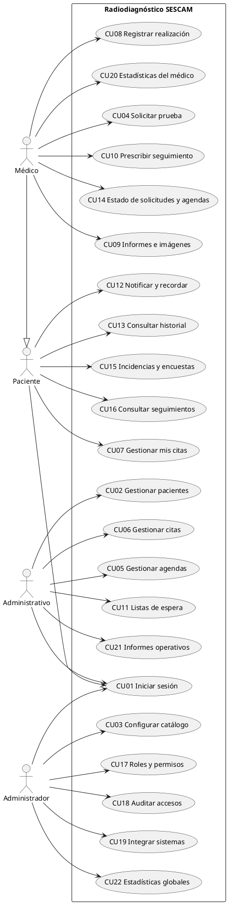
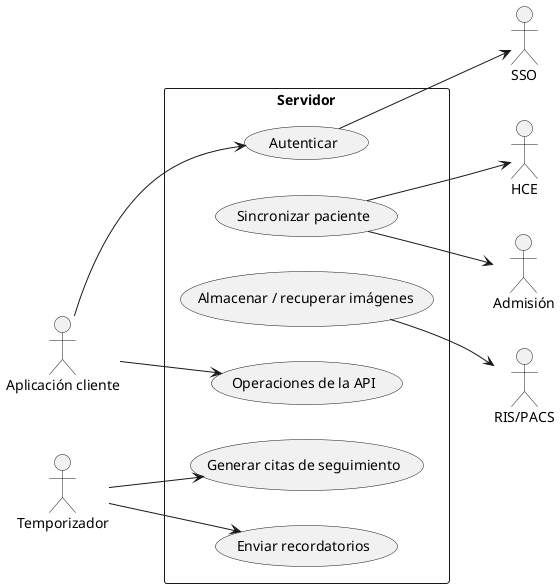

# Requisitos y casos de uso

## 1. Actores

| Actor | Tipo | Descripción |
|---|---|---|
| Paciente | Humano | Usuario básico: citas, notificaciones, historial, incidencias y encuestas |
| Médico | Humano | **Hereda del Paciente** (D-005). Solicita pruebas, seguimientos, informes, estadísticas |
| Administrativo | Humano | Personal de admisión: pacientes, citas, agendas, listas de espera, informes operativos |
| Administrador | Humano | Configuración, roles y permisos, auditoría, integración, estadísticas globales |
| Aplicación cliente | Sistema | Actor del diagrama del servidor: invoca las interfaces `api` |
| SSO, HCE, Admisión, RIS/PACS | Sistema externo | Simulados con interfaces (D-009) |
| Temporizador | Sistema | Dispara recordatorios y genera citas de seguimiento |

## 2. Requisitos funcionales (1 RF : 1 CU, D-004)

| RF | Descripción | Actor | CU |
|---|---|---|---|
| RF01 | Consultar y gestionar sus citas: confirmar, solicitar cambio o cancelar | Paciente | CU07 |
| RF02 | Recibir notificaciones y recordatorios de citas, preparación e informes disponibles | Paciente | CU12 |
| RF03 | Consultar el historial de pruebas realizadas | Paciente | CU13 |
| RF04 | Comunicar incidencias y responder encuestas de satisfacción | Paciente | CU15 |
| RF05 | Consultar información de pruebas de seguimiento y revisiones periódicas | Paciente | CU16 |
| RF06 | Solicitar una prueba con indicación clínica, justificación y prioridad | Médico | CU04 |
| RF07 | Prescribir pruebas de seguimiento periódicas que generan nuevas solicitudes | Médico | CU10 |
| RF08 | Consultar el estado de sus solicitudes y las agendas disponibles | Médico | CU14 |
| RF09 | Crear informes y consultar informes e imágenes de sus pacientes | Médico | CU09 |
| RF10 | Registrar la realización de la prueba y sus incidencias | Médico | CU08 |
| RF11 | Consultar estadísticas de sus solicitudes (espera, recursos, adherencia) | Médico | CU20 |
| RF12 | Alta, modificación y baja de pacientes | Administrativo | CU02 |
| RF13 | Gestionar citas: asignar, reprogramar y cancelar | Administrativo | CU06 |
| RF14 | Gestionar las agendas de cada día (sala/equipo y médico) | Administrativo | CU05 |
| RF15 | Gestionar listas de espera, prioridades y huecos de agenda | Administrativo | CU11 |
| RF16 | Generar informes operativos: ocupación, tiempos de espera, cancelaciones | Administrativo | CU21 |
| RF17 | Configurar parámetros: tipos de prueba, horarios, políticas de citación | Administrador | CU03 |
| RF18 | Gestionar roles y permisos | Administrador | CU17 |
| RF19 | Auditar actividades y accesos a datos clínicos | Administrador | CU18 |
| RF20 | Integrar con SSO, HCE, admisión y RIS/PACS | Administrador | CU19 |
| RF21 | Generar estadísticas globales y reportes de uso | Administrador | CU22 |
| RF22 | Iniciar y cerrar sesión (SSO corporativo) — **añadido** (D-004) | Todos | CU01 |

## 3. Casos de uso priorizados y asignados a fases

Criterio de prioridad: primero los CU que crean las **entidades centrales y los adaptadores** (línea base
de la arquitectura), después los que dependen de ellos, y al final consultas y estadísticas.

| Prioridad | CU | Nombre | Fase | Complejidad | Especificación |
|---|---|---|---|---|---|
| 1 | CU01 | Iniciar sesión | Elaboración | Media | [CU01](../casos-de-uso/CU01.md) |
| 2 | CU02 | Gestionar pacientes | Elaboración | Media | [CU02](../casos-de-uso/CU02.md) |
| 3 | CU03 | Configurar catálogo y parámetros | Elaboración | Media | [CU03](../casos-de-uso/CU03.md) |
| 4 | CU04 | Solicitar prueba | Elaboración | Alta | [CU04](../casos-de-uso/CU04.md) |
| 5 | CU05 | Gestionar agendas | Elaboración | Alta | [CU05](../casos-de-uso/CU05.md) |
| 6 | CU06 | Gestionar citas | Elaboración | Alta | [CU06](../casos-de-uso/CU06.md) |
| 7 | CU07 | Gestionar mis citas | Construcción | Media | [CU07](../casos-de-uso/CU07.md) |
| 8 | CU08 | Registrar realización e incidencias | Construcción | Media | [CU08](../casos-de-uso/CU08.md) |
| 9 | CU09 | Gestionar informes e imágenes | Construcción | Alta | [CU09](../casos-de-uso/CU09.md) |
| 10 | CU10 | Prescribir seguimiento | Construcción | Alta | [CU10](../casos-de-uso/CU10.md) |
| 11 | CU11 | Gestionar listas de espera | Construcción | Media | [CU11](../casos-de-uso/CU11.md) |
| 12 | CU12 | Notificar y recordar | Construcción | Media | [CU12](../casos-de-uso/CU12.md) |
| 13 | CU13 | Consultar historial | Construcción | Baja | [CU13](../casos-de-uso/CU13.md) |
| 14 | CU14 | Consultar estado de solicitudes y agendas | Construcción | Baja | [CU14](../casos-de-uso/CU14.md) |
| 15 | CU15 | Comunicar incidencias y encuestas | Construcción | Baja | [CU15](../casos-de-uso/CU15.md) |
| 16 | CU16 | Consultar seguimientos | Construcción | Baja | [CU16](../casos-de-uso/CU16.md) |
| 17 | CU17 | Gestionar roles y permisos | Construcción | Media | [CU17](../casos-de-uso/CU17.md) |
| 18 | CU18 | Auditar accesos | Construcción | Media | [CU18](../casos-de-uso/CU18.md) |
| 19 | CU19 | Integrar sistemas hospitalarios | Construcción | Alta | [CU19](../casos-de-uso/CU19.md) |
| 20 | CU20 | Consultar estadísticas del médico | Construcción | Media | [CU20](../casos-de-uso/CU20.md) |
| 21 | CU21 | Generar informes operativos | Construcción | Media | [CU21](../casos-de-uso/CU21.md) |
| 22 | CU22 | Generar estadísticas globales | Construcción | Baja | [CU22](../casos-de-uso/CU22.md) |

## 4. Diagrama general de casos de uso (cliente)

## 5. Diagrama del servidor (actores de tipo sistema)

